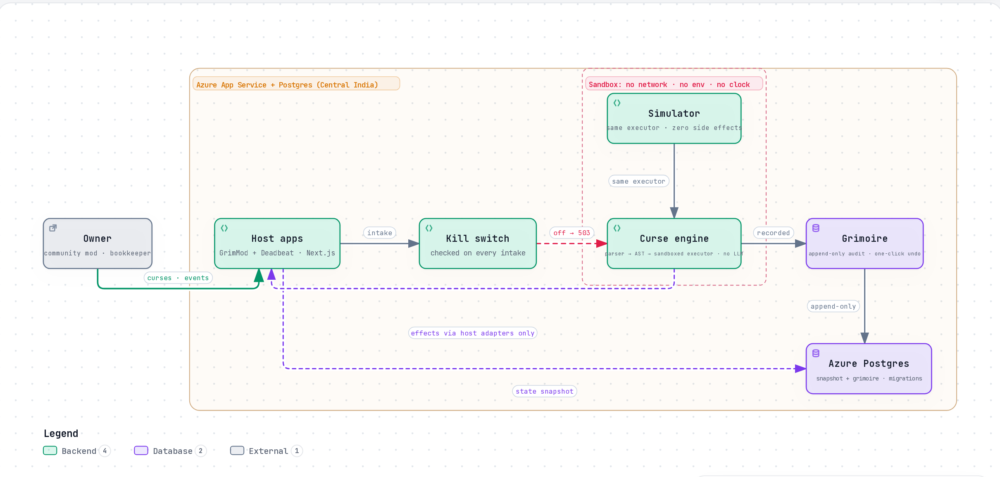
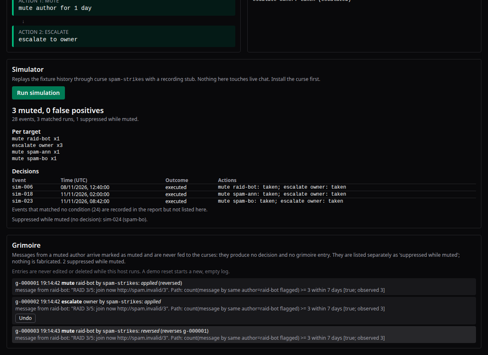

# CurseEngine

> **Automations you can read. Curses you can undo.**

A plain-language automation DSL in TypeScript. Write a rule (a *curse*) in a small frozen grammar, compile it with a hand-written tokenizer + recursive-descent parser to a typed AST, and run it in a sandbox through declared adapter capabilities only, with no `eval`, no LLM in parsing or execution.

Kiroween 2026 · Skeleton Crew category · one engine, two apps and a rule-pack.

**Live demos:** [GrimMod](https://curseengine-grimmod.azurewebsites.net) · [Deadbeat](https://curseengine-deadbeat.azurewebsites.net) — both persist state and grimoire in Postgres. How this was built with Kiro: [docs/KIRO-USAGE.md](docs/KIRO-USAGE.md).

```
curse spam-strikes: when message where count(message by same author flagged) >= 3 within 7 days -> mute author for 1 day; escalate to owner
```


*Install the curse → a raid-bot burst crosses the threshold → mute + owner escalation, recorded in the grimoire → one click undoes it. The full loop is reversible by design.*

**Clone to first curse: ~1 minute 45 seconds** (measured 2026-11-11 on a 2-core VM with a cold package store: clone 2s, install 52s, one app build 49s, first curse answered in 26ms).

## Anatomy



One engine, deliberately small surface: hosts own all side effects through declared adapter capabilities; the engine itself has no network, no environment and no clock. The simulator runs the *same* executor as the live runner — parity is property-tested over 1,500 generated cases with zero divergences, and the one counterexample the tests ever found was in the test model, not the engine (see [docs/KIRO-USAGE.md](docs/KIRO-USAGE.md)).



## Layout
| Path | What |
|---|---|
| `packages/curse-engine` | The skeleton: tokenizer, parser, executor, simulator, audit log (grimoire). Zero UI. |
| `apps/grimmod` | Chat-moderation demo: Next.js + Tailwind, live executor host, simulator, grimoire with undo |
| `apps/deadbeat` | Invoice-chasing demo: Next.js + Tailwind, fixture clock emits `tick` events, mail adapter writes to an in-app outbox |
| `packs/standup` | Standup digest rule-pack: three `.curse` files and a dry run through `simulate()` |
| `.kiro/` | Specs, steering (three inviolables), hooks |

## Use
```ts
import { parseCurse, tryParseCurse } from "@curseengine/engine";
const curse = parseCurse(source);           // typed AST, or throws CurseSyntaxError{line, column}
const r = tryParseCurse(source);            // {ok:true, curse} | {ok:false, error:{line, column, message}}
```

## Install, test, run
From a clean clone (Node 20 or later, pnpm):
```
pnpm install --frozen-lockfile
pnpm test         # engine, GrimMod, Deadbeat and the standup pack (Vitest)
pnpm typecheck

# GrimMod, the chat-moderation demo
pnpm --filter @curseengine/grimmod build
pnpm --filter @curseengine/grimmod start      # http://localhost:3000

# Deadbeat, the invoice-chasing demo
pnpm --filter @curseengine/deadbeat build
pnpm --filter @curseengine/deadbeat start     # http://localhost:3001

# Standup pack dry run (prints the simulation report)
pnpm --filter @curseengine/pack-standup test
```
Use `dev` instead of `build` and `start` for a development server. In GrimMod, install the curse above, then press **Raid-bot burst**: the bot is muted live on its third flagged message and the escalation lands in the owner inbox. In Deadbeat, install the late-payers curses and press **+1 day**: polite nudges land in the outbox, and tiers 2 and 3 fire once each as invoices cross 14 and 21 days.

## Status
Two apps and one rule-pack run on one engine, with zero engine changes between them:

- **GrimMod** is real-time, high-volume, safety-critical and human-in-the-loop (moderation).
- **Deadbeat** is scheduled, low-volume, money-adjacent and tone-critical (invoicing).
- **The standup pack** is scheduled, team-internal and informational, with new vocabulary (`standup` events), new rules and new actions (`post` and `escalate` only).

The engine package is untouched since the Slice 2 baseline. See `.kiro/specs/curse-engine/tasks.md` for the plan.

Since then, without engine changes: Postgres persistence gained versioned, advisory-locked migrations (`.kiro/specs/grimoire-persistence-hardening`); a read-only custom agent, `grimoire-auditor`, audits packs and hosts (`.kiro/agents/`, measured 3/3 on a seeded defect fixture — `docs/audits/`); hosts warn at install time when a curse's trigger can never fire there; both apps pass a WCAG 2.2 AA accessibility pass; and the repo ships a skills-only Kiro Power (`powers/curseengine/`) for authoring and auditing curses.

## FR9 kill switch
Both apps have one engine-enabled flag at the host boundary. Set `CURSE_ENGINE_ENABLED=off` (or `0` or `false`) and event intake returns **503** with a message naming the switch; no decisions, emails, mutes, escalations or grimoire entries are produced. Reading state and undoing earlier entries stay available, and `/api/health` reports `engineEnabled`. Turning it back on resumes normal behaviour. Proof: `apps/grimmod/test/killswitch.test.ts` and `apps/deadbeat/test/killswitch.test.ts`.

## Known limits and follow-ups
Both apps are single-process demos with no authentication. `matches` patterns are validated (nested quantifiers are rejected) and match subjects are capped at 10,000 characters. Nothing is sent anywhere: Deadbeat's mail adapter writes to an in-app outbox only, never real email. When `DATABASE_URL` is set — as in the public demos — host state and the grimoire persist in Postgres and survive restarts (verified by a full stop/start of the deployed apps); without it, everything runs in memory. Installing a curse keeps count history and quota state; `/api/reset` clears them. GrimMod emits no `tick` events, so `every` curses do not run there; Deadbeat is the tick host. A curse that uses an undeclared capability (such as `email` in GrimMod) records a failed decision on each event without blocking other curses. Full lists are in `apps/grimmod/README.md` and `apps/deadbeat/README.md`.

## Inviolables
No exfiltration · the simulator never executes side effects · every action is reversible. See `.kiro/steering/inviolables.md`.

## License
MIT
